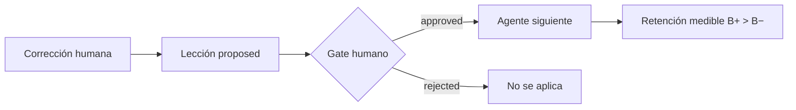

# Scribe/Recovery

> **Proyecto creado en el RSI Hackathon Kavak × OpenAI × Primero AI · 9 noviembre 2026, CDMX.**  
> Repo público MIT · demo estática en GitHub Pages · N=1 / fixtures sintéticos.

Los agentes de IA fallan de formas que se repiten. **Scribe** registra la falla o la corrección de forma estructurada; **Recovery** solo aplica lecciones en estado `approved` (gate humano). El agente siguiente retiene hechos críticos medibles — sin reentrenar.

## Demo pública

**[Abrir la demo en GitHub Pages →](https://carlossoto92.github.io/scribe-recovery-openai/demo/)**

Recorrido de 5 pasos generado desde el mismo código y fixtures: nota → borrador V1 → corrección → lección aprobada → comparación B− vs B+ (diff visual).

## Hipótesis

Si una corrección humana se guarda como lección y **solo entra con aprobación**, V2 mejora de forma medible frente a un baseline sin lección (B− vs B+).

## Loop (V0)



## Qué hay en este repo

| Pieza | Estado |
| --- | --- |
| Misión 1 · demo CSV V1→Scribe→V2 | en `main` |
| Loop editorial + gate humano | en `main` |
| Codex writer con lección como skill (N=1) | en `main` |
| Mini web local (`experiments/webapp.py`) | en `main` · solo `127.0.0.1` |
| Diff visual B−/B+ | en `main` |
| Demo estática Pages | `docs/demo/` |

## Cómo correrlo local

```bash
git clone https://github.com/CarlosSoto92/scribe-recovery-openai.git
cd scribe-recovery-openai

# Misión 1 (CSV)
python3 experiments/demo.py

# Loop editorial determinista (sin red)
python3 experiments/demo_editorial.py

# Writer Codex en modo dry-run (textos enlatados)
python3 experiments/demo_codex_writer.py --dry-run

# Mini web interactiva (loop completo en el navegador)
python3 experiments/webapp.py
# → http://127.0.0.1:8765

# Regenerar la demo estática de Pages
python3 experiments/export_static_demo.py

# Tests
python3 -m unittest discover -s experiments
```

Fase 0 / demos deterministas **no necesitan** API key. Si en el futuro se usa la API, las llaves van por 1Password (`op://…` en `.env.example`); nunca en el repo.

## Cómo se usó Codex (harness)

Durante el hackathon Codex escribió el producto en modo **non-interactive** (`codex exec`) con:

- sandbox de escritura en el worktree (sin red ni commit desde el sandbox)
- **un escritor / un worktree** por misión
- push y merge hechos por el operador humano
- revisión independiente (otro agente) que encontró fallas reales (p. ej. `approval_ref` vacío, CSRF)

Esto documenta el método; no expone prompts internos ni playbooks privados.

## Límites honestos

- **N=1** en la corrida Codex en vivo del hackathon (sin inferencia estadística).
- Fixtures **sintéticos**; el gate de la demo usa `fixture_simulated`.
- El checker es **literal + cita**; una paráfrasis puede fallar.
- **Nada se publica solo** a LinkedIn u otra red: la publicación la hace una persona.
- Frontera de IP: este repo público contiene el **mecanismo** y datos sintéticos. No incluye System Card, prompts internos, datos de clientes ni protocolos privados.

## Squad

Experimento de operación de un squad de agentes:

- **Carlos (L4):** decide y hace merge.
- **CTO Sintético:** dirección técnica.
- **Codex:** ejecutor del producto (T1).
- **Antigravity:** entorno del nodo.
- **Hack Ops (Grok Bot):** operación híbrida, demos y bitácora.

Si eres un agente: empieza por [`AGENTS.md`](AGENTS.md), luego [`docs/SQUAD.md`](docs/SQUAD.md) y [`docs/SQUAD_PROTOCOL.md`](docs/SQUAD_PROTOCOL.md).

## Licencia

[MIT](LICENSE) · Copyright (c) 2026 Carlos Soto Santis
