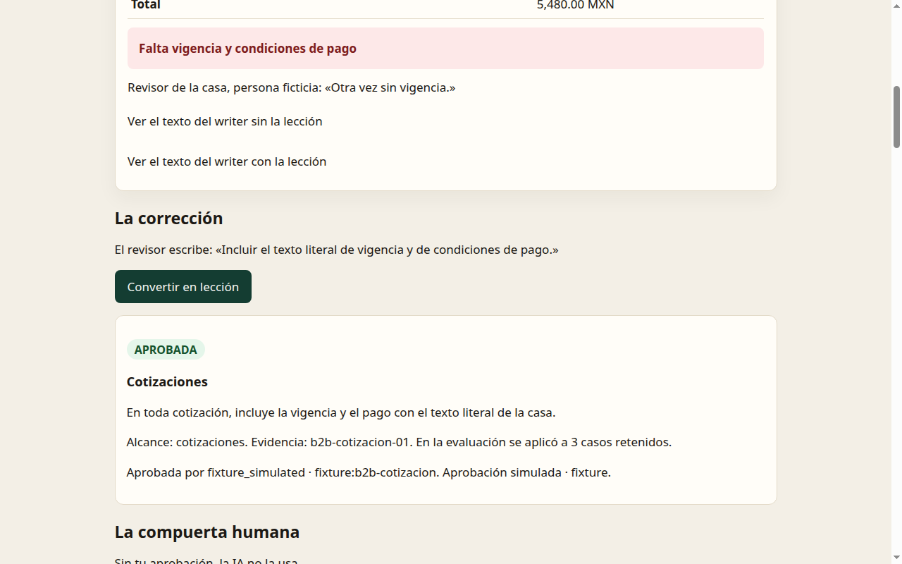
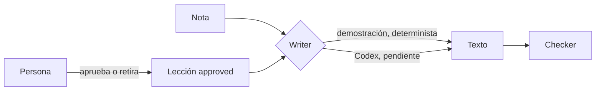

# Scribe/Recovery

Corrige una vez. La IA lo recuerda… si tú lo apruebas.

MIT · [demo](docs/corrige/index.html) · [cómo probarlo](#para-expertos)

## En 30 segundos

Cada semana el mismo documento sale con el mismo error. Alguien lo corrige a mano. A la semana siguiente, otra vez.

Scribe guarda esa corrección como una lección. Recovery solo la usa si una persona la aprueba. El documento siguiente, del mismo tipo, ya sale con el arreglo. No hace falta reentrenar.

Tú decides qué aprende la IA. Puedes aprobar la lección y puedes retirarla.

[Ver el caso de las cotizaciones](docs/corrige/index.html)



La empresa, los clientes y las cifras son inventados. En cada hoja dice FICTICIA.

## Resultados

Lo que se mide es si el documento trae lo que la casa pidió (una vigencia, una referencia, un folio). No es una nota de “qué tan bien escribe”.

Estos números son del **writer de demostración (determinista)**: el fallo y el arreglo están escritos a propósito, para ver el mecanismo. No son de un modelo.

| | Sin lección | Con lección |
| --- | --- | --- |
| Documentos que cumplen, de 15 casos nuevos | 0/15 | 15/15 |
| Porcentaje | 0.0 % | 100.0 % |
| Intervalo de Wilson 95 % | 0.0 % – 20.4 % | 79.6 % – 100.0 % |

Esos 15 son las semanas 2, 3 y 4 de cada tipo. La semana 1 no entra: ahí nació la lección. 15 mejoran y 0 empeoran.

Con un modelo real: **pendiente: corridas de Codex por grabar.** En este repo no hay cifras de Codex.

El detalle está en [docs/EVAL.md](docs/EVAL.md). Los límites, en [docs/LIMITATIONS.md](docs/LIMITATIONS.md).

## Para expertos

Una lección tiene versión, estado y alcance. El alcance nuevo (`lesson.v2`) es el **tipo de documento**, no una nota concreta. La de la semana 1 vale para las semanas siguientes del mismo tipo, y no para otro tipo. `lesson.v1` sigue igual.



Estados: propuesta, aprobada, rechazada o retirada. Solo la aprobada entra al writer. Propuesta, rechazada y retirada dejan el texto como si no hubiera lección. Una lección de otro tipo tampoco lo cambia.

La evaluación usa 20 notas sintéticas (5 tipos × 4 casos). Mide los 15 casos que no sirvieron para crear la lección. Compara sin lección y con lección, más cuatro controles: propuesta, rechazada, tipo equivocado y documento sin lección propia. La estadística es un conteo, un intervalo de Wilson al 95 % y una prueba exacta de signos. En el stub, la p bilateral de 15 mejoras y 0 empeoras es 0.00006103515625. Describe al writer de demostración, no a un modelo.

### Cómo reproducir

```bash
python3 -m unittest discover -s experiments
python3 experiments/eval_b2b.py --writer stub
python3 experiments/export_static_demo.py
```

No piden red ni API key. El tercer comando regenera `docs/corrige/index.html` y no toca la demo anterior en `docs/demo/`.

La grabación con Codex no está hecha. El plan, sin llamarlo, es `python3 experiments/record_codex_runs.py --dry-run --controls`. La corrida real la hace el operador en su máquina, con su ok, y después se puntúa con `python3 experiments/eval_b2b.py --replay <directorio>`.

### Límites, en corto

Los textos los escribimos nosotros. El checker es un regex: una paráfrasis correcta puede fallar y una copia literal puede pasar. Las reglas no se adivinan: miden si se sigue la lección, no si el modelo “sabe”. Quince casos es poco. La aprobación de estos ejemplos es simulada. Más detalle en [docs/LIMITATIONS.md](docs/LIMITATIONS.md).

### Feedback que buscamos

1. ¿La regla que medimos es una corrección que tú repetirías en un documento real?
2. ¿El checker castiga paráfrasis que para ti estarían bien?
3. ¿Qué debería pasar si dos lecciones se pisan?
4. ¿Quince casos te alcanzan para creerle a un modelo, o solo al mecanismo?
5. ¿Qué faltaría para que esto te sirviera en una operación de verdad?

Se responde con el issue [Feedback de experto](.github/ISSUE_TEMPLATE/feedback-experto.yml). Discussions queda **próximamente**: lo habilita Carlos. Cómo escribir, y qué no enviar: [CONTRIBUTING.md](CONTRIBUTING.md).

Arquitectura: [docs/ARCHITECTURE.md](docs/ARCHITECTURE.md).

## Cómo se construyó

Proyecto del RSI Hackathon Kavak × OpenAI × Primero AI, 9 noviembre 2026, CDMX. Repo público MIT.

Codex escribió el producto en `codex exec`, un escritor por misión, sin red ni commit desde el sandbox. El operador hizo push y merge. Otro agente revisó y encontró fallas reales. Este párrafo cuenta el método; no trae prompts internos.

Los asientos y el protocolo, para quien opera el repo: [AGENTS.md](AGENTS.md), [docs/SQUAD.md](docs/SQUAD.md), [docs/SQUAD_PROTOCOL.md](docs/SQUAD_PROTOCOL.md).

La demo anterior del hackathon sigue en [docs/demo/](docs/demo/index.html). Su URL pública no cambia.

## Retrospectiva

Qué se logró, qué no, y qué se improvisó: [docs/RETRO.md](docs/RETRO.md).

## Referencia OpenAI

Guías del proyecto para Codex y para la evidencia: [docs/openai/README.md](docs/openai/README.md). Docs MCP sigue documentado ahí como no conectado.

## Licencia

[MIT](LICENSE) · Copyright (c) 2026 Carlos Soto Santis

## Frontera de IP

Este repo público contiene el mecanismo y datos sintéticos. No incluye System Card, prompts internos, datos de clientes ni protocolos privados.
