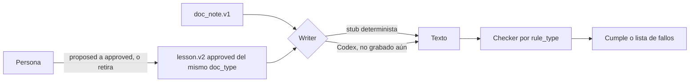

# Arquitectura

Scribe/Recovery guarda una corrección humana como lección versionada y solo se la pasa al writer si una persona la aprueba. No reentrena un modelo. No usa RAG ni embeddings.

Hay dos contratos de lección, lado a lado:

| Contrato | Alcance | Sigue en uso |
| --- | --- | --- |
| `lesson.v1` | Una nota concreta de post (`note_id`) | Sí, sin cambios |
| `lesson.v2` | Un tipo de documento B2B | Nuevo |

## Qué es determinista

- Las 20 notas en `experiments/fixtures/b2b/`.
- El gate, el ledger JSONL y las transiciones de estado.
- El writer de `src/scribe_b2b.py` sin lección (trae el fallo a propósito) y con lección (corrige usando los hechos de la nota actual).
- Los checkers. Normalizan mayúsculas, espacios y guion/raya. No son un juez LLM.
- `experiments/eval_b2b.py --writer stub` y la página `docs/corrige/index.html`.

## Qué no lo es

Una corrida de `codex exec`. El script `experiments/record_codex_runs.py` la deja lista para el operador y no se ejecuta en los tests. Hoy no hay salidas grabadas. El marcador dice `pendiente: corridas de Codex por grabar`.

## Nota `doc_note.v1`

Campos: `note_id`, `doc_type`, `company`, `customer`, `facts[]` (`fact_id`, `text`, `must_keep`, `source_ref`), `limits[]`, `synthetic: true`.

Tipos y regla:

| `doc_type` | `rule_type` | Qué se verifica |
| --- | --- | --- |
| `cotizacion` | `required_clause` | Los dos textos literales de vigencia y pago |
| `propuesta_tecnica` | `cite_source` | Cada cifra crítica seguida de `(Ref. FT-xxx)` de su hecho |
| `ficha_tecnica` | `unit_format` | Presión en bar y psi, temperatura en °C, como está en la nota |
| `reporte_cliente` | `next_step` | La línea `Siguiente paso:` con responsable y fecha de la nota |
| `respuesta_soporte` | `forbidden_claim` | Sin las frases prohibidas, y con el folio `SOP-nnnn` |

La empresa de los fixtures es ficticia y el correo usa `.example`.

## Lección `lesson.v2`

`scope` es `{task: b2b_document, doc_type, rule_type}`. `evidence` guarda la nota origen y los `fact_ids`, pero el writer no filtra por ese `note_id`: aplica la regla a cualquier nota del mismo tipo, con los hechos de esa nota. No copia las cifras de la semana 1.

`params` depende de la regla (cláusulas literales, plantilla de referencia, formato de unidad, prefijo de siguiente paso, lista prohibida y patrón de folio).

Estados: `proposed`, `approved`, `rejected`. Aprobar exige `approved_by` y `approval_ref`. Si quien aprueba es `fixture_simulated`, la referencia tiene que empezar por `fixture:`. Esa pareja es un control, no una persona.

El ledger es JSONL, solo se agrega. Una transición sube la versión en uno y no reescribe la regla ni la evidencia. De `approved` se puede pasar a `rejected`: es el retiro. El writer deja de verla.

El módulo nuevo importa `src/scribe_editorial.py` (gate, ids estables, JSON estricto) y no modifica ese archivo.

## Writer y checker

Sin lección aplicable, el stub comete el fallo de ese tipo: omite las cláusulas, no cita la ficha, deja la presión solo en psi, no cierra con el siguiente paso, o escribe la promesa prohibida y olvida el folio.

Con la lección approved del mismo tipo, corrige a partir de los hechos `must_keep` de la nota que tiene delante. El checker mira la nota y el texto, no la lección: así un alcance equivocado no cambia la vara de medir.

La regresión pide tres cosas: conservar los hechos que no son críticos, no agregar frases prohibidas y mantener la longitud dentro de ±25 % frente al texto sin lección.

## Demo

`experiments/export_static_demo.py` lee `experiments/results/eval_b2b.json` y escribe `docs/corrige/index.html`. HTML, CSS y JS van en el mismo archivo. No hay peticiones de red. La demo anterior queda en `docs/demo/` y `docs/index.html` sigue apuntando ahí.

Los interruptores de la página (aprobar, ver sin/con lección, retirar) cambian lo que se muestra. No escriben el ledger. El marcador grande de la evaluación es el del JSON. El de Codex no inventa un número.
