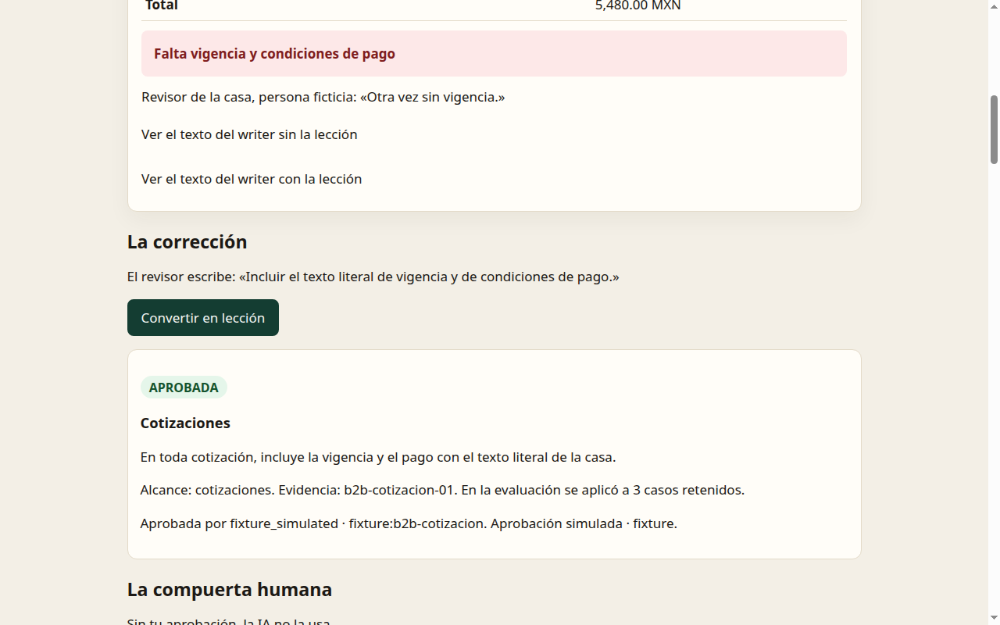

# Material para compartir

Página corta para quien quiera hablar de este experimento sin inflarlo. Todo lo de aquí sale de [`NOTA_EXPERIMENTO.md`](NOTA_EXPERIMENTO.md) y [`EVAL.md`](EVAL.md); si algo no coincide, mandan esos archivos.

> **Aviso de madurez:** es un experimento de hackathon, construido en un día y medio. Es una nota de laboratorio, no un paper.
>
> **Estado:** experimento terminado (nov 2026). No habrá corridas nuevas en este repo; las cifras de esta página son las finales.

## La línea de resultado

> En un caso B2B **sintético**, con **Codex**, una lección aprobada por tipo de documento subió el cumplimiento **literal** de 33 % a 63 % (prueba de signos exacta: 11 mejoran, 2 empeoran, 17 empatan; p = 0.022).

Con un segundo revisor, más flexible y **escrito después de ver los resultados** (por eso es un techo optimista, no el resultado primario), la misma comparación fue de 80 % a 100 %.

Un ejemplo concreto: en la propuesta técnica, la regla «cita la ficha técnica junto a cada cifra» pasó de 0 de 6 a 5 de 6 con el revisor estricto, y a 6 de 6 con el tolerante.

Lo que **no** dice esta línea: que funcione en otras empresas, que se repita con otros modelos (solo se midió Codex), que la aprobación humana funcione en una operación real (aquí fue simulada) ni que mejore la calidad editorial en general.

## De qué trata, en tres líneas

1. Una corrección humana se vuelve una lección.
2. Una persona la aprueba; solo una lección aprobada se usa.
3. El siguiente documento del mismo tipo ya la trae, sin reentrenar el modelo.

La empresa del caso, **Válvulas y Bombas Ejemplo del Bajío, S.A. de C.V.**, y sus clientes, folios y cifras son inventados. En cada hoja de la demo dice FICTICIA.



## Enlaces

| Qué | Dónde |
| --- | --- |
| La historia, en un cartel (resumen visual para no expertos) | https://carlossoto92.github.io/scribe-recovery-openai/historia/ |
| Demo «Corrige una vez» | https://carlossoto92.github.io/scribe-recovery-openai/corrige/ |
| Demo del hackathon (domingo 9 de nov) | https://carlossoto92.github.io/scribe-recovery-openai/demo/ |
| Nota del experimento (resultados y límites) | [`NOTA_EXPERIMENTO.md`](NOTA_EXPERIMENTO.md) |
| Evaluación completa | [`EVAL.md`](EVAL.md) |
| Límites | [`LIMITATIONS.md`](LIMITATIONS.md) |
| Arquitectura | [`ARCHITECTURE.md`](ARCHITECTURE.md) |
| Retrospectiva | [`RETRO.md`](RETRO.md) |
| README | [`../README.md`](../README.md) |

## Lo que esto no demuestra (resumen)

- Una sola empresa sintética y una muestra pequeña: los intervalos son anchos.
- Un solo modelo, una versión, un día y un operador.
- La aprobación humana de la lección fue simulada.
- Las notas, las reglas y los dos revisores los escribimos nosotros; ambos son revisores automáticos y no miden calidad editorial.
- Las repeticiones de una misma nota no son del todo independientes.
- No se midió si la revisión entre familias de modelos mejora los documentos.

La lista completa y su explicación están en la nota y en [`LIMITATIONS.md`](LIMITATIONS.md).

## Reproducirlo

Sin red y sin llave de API (se puntúan las salidas ya grabadas):

```bash
python3 -m unittest discover -s experiments
python3 experiments/eval_b2b.py --replay experiments/recorded/codex-20261110
```

El segundo comando reescribe `docs/EVAL.md` y el JSON de resultados en tu copia local; hazlo en un clon desechable si no quieres cambios en tu árbol. No ejecutes `experiments/record_codex_runs.py`: llama a Codex y lo opera quien mantiene el repo.

## Cómo citarlo

> Soto Santis, C. (2026). *Scribe/Recovery · «Corrige una vez»: nota de laboratorio de un experimento de hackathon.* Repositorio de código abierto (MIT). https://github.com/CarlosSoto92/scribe-recovery-openai. Commit `c76a929`, 11 de noviembre de 2026.

Las cifras no cambian desde el commit `7198164` (10 de noviembre); los commits posteriores solo agregan el cartel y documentación.

Si citas una cifra, di de qué revisor es (estricto o tolerante), que el caso es sintético y que solo se midió Codex.

## Dar feedback

Lo más útil es una crítica concreta: un archivo, una línea, un ejemplo.

1. Abre un issue con la plantilla [**Feedback de experto**](https://github.com/CarlosSoto92/scribe-recovery-openai/issues/new?template=feedback-experto.yml).
2. Puedes empezar por estas preguntas, que son donde más nos sirve tu mirada:
   - ¿La regla que medimos es una corrección que repetirías en un documento real?
   - ¿El revisor castiga paráfrasis que a ti te parecerían bien?
   - ¿Qué debería pasar si dos lecciones se pisan?
   - ¿Quince casos retenidos te alcanzan para creerle a un modelo, o solo al mecanismo?
   - ¿Qué faltaría para que esto sirviera en una operación de verdad?
3. No envíes datos de clientes, documentos reales, correos, teléfonos, llaves ni material interno. Detalle en [`CONTRIBUTING.md`](../CONTRIBUTING.md).

Discussions queda **próximamente**: lo habilita el autor.

## Origen

Proyecto del RSI Hackathon Kavak × OpenAI × Primero AI, 9 de noviembre de 2026, CDMX. Licencia [MIT](../LICENSE).

Este repo público contiene el mecanismo y datos sintéticos. No incluye datos de clientes, prompts internos ni protocolos privados.
