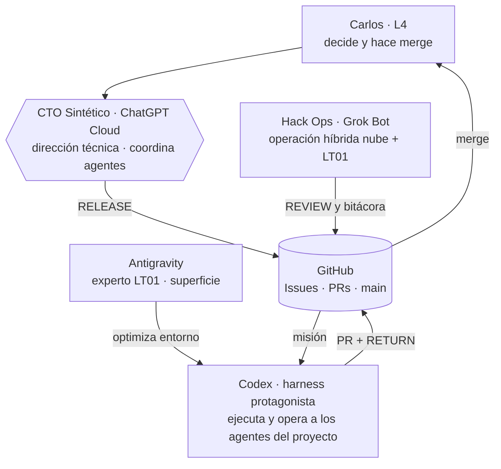

# Squad — un asiento por agente

Versión hackathon (9 nov 2026). Basado en el *Synthetic Squad Operating Map* v0.1 de
[`diimenet-agent-infra-lab`](https://github.com/CarlosSoto92/diimenet-agent-infra-lab/blob/main/docs/SYNTHETIC_SQUAD_OPERATING_MAP.md), en versión ligera.

| Asiento | Quién | Misión | Puede tocar | No toca | Entrega | Reporta a |
|---|---|---|---|---|---|---|
| **L4** | Carlos Soto | Decisiones finales, prioridades, merge y gates T2 | Todo | — | `L4_DECISION` en el Issue | — |
| **CTO Sintético** | ChatGPT (nube) | Arquitectura, investigación, mandatos técnicos y evaluación con criterio C-level. Coordina a cualquier agente nuevo | Issues (`RELEASE`), `docs/DECISIONS.md` vía PR | Código de producto; merge | `RELEASE` por misión; veredicto final de cada `REVIEW` | Carlos |
| **Codex** | OpenAI Codex CLI en LT01 | **Ejecuta.** Escribe el código y opera a los agentes empleados del proyecto | `src/` y lo que aparte en su `CLAIM` | `main` directo, secretos, acciones T2 sin gate | `CLAIM`, PR y `RETURN` | CTO Sintético |
| **Antigravity** | Antigravity CLI en LT01 | Experto en LT01: optimiza la superficie donde corre Codex (recursos, config de Codex, herramientas, versiones) | Configuración del nodo LT01 y `experiments/env/` vía PR | Código de producto; WS01 | Diagnósticos y recomendaciones de entorno en el Issue | CTO Sintético |
| **Hack Ops** | Grok Bot | Operación híbrida nube + LT01: prepara repo e Issues, parte el trabajo en tareas chicas para Codex, revisa diffs y tests, bitácora, alertas de tiempo y guion del demo | Docs, plantillas e Issues vía PR; lectura de LT01 | Código de producto; cambios en LT01 sin ok de Carlos; merge | `REVIEW` técnico, bitácora, checklist del demo | Carlos y CTO Sintético |
| **Agentes empleados** | Los que Codex opere dentro del proyecto | Lo que Codex les asigne | Solo la superficie de la misión de Codex | Fuera del lock de Codex | Trabajo dentro del PR de Codex | Codex |

## Cómo entra un agente nuevo

1. El CTO Sintético le asigna asiento y lo agrega a esta tabla por PR.
2. El agente lee `AGENTS.md`, este archivo y `docs/SQUAD_PROTOCOL.md`.
3. Trabaja solo a través de Issues y PRs.
