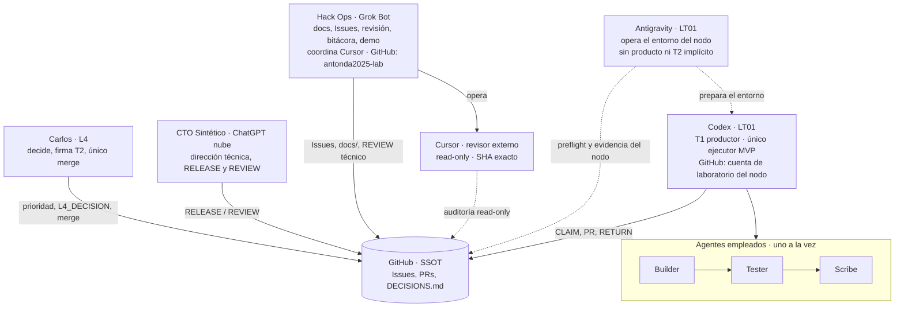
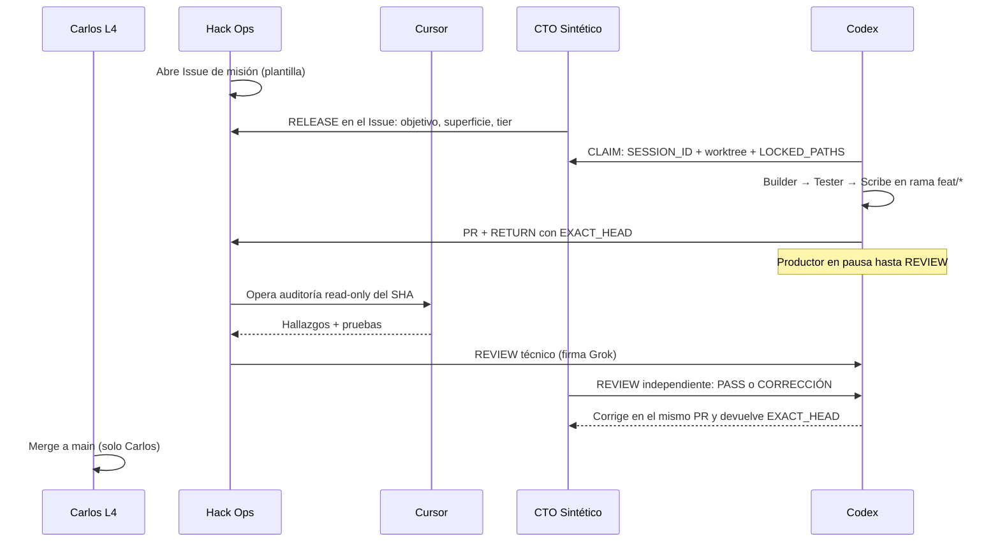
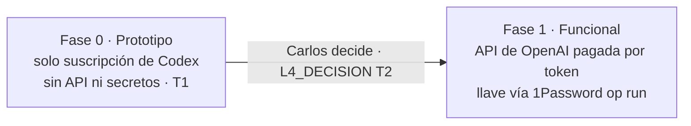

# Cómo opera el squad

Vista rápida de quién hace qué y cómo fluye una misión. Las reglas completas están en [`AGENTS.md`](../AGENTS.md), [`SQUAD.md`](SQUAD.md) y [`SQUAD_PROTOCOL.md`](SQUAD_PROTOCOL.md). GitHub es la fuente de verdad.

## 1. Asientos y fronteras

| Asiento | Puede tocar | No puede |
|---|---|---|
| Carlos (L4) | Todo; merge a `main`; gates T2 | — |
| CTO Sintético | `RELEASE`, `REVIEW`, `docs/` vía PR | Código de producto, merge |
| Hack Ops | `docs/`, plantillas, Issues, revisión; lectura de LT01; opera Cursor | Código de producto, cambios en LT01 sin ok, merge, escritura en rama del productor |
| Antigravity | Entorno LT01 dentro de autorizaciones L4 | Producto, merge, secretos/API/túneles sin gate T2 |
| Codex | `src/`, `experiments/`, ramas `feat/*` (T1 productor) | `main` directo, secretos, T2 sin gate; no auto-revisa |
| Cursor | Checkout aislado read-only del SHA del productor | Escritura en rama Codex, secretos, merge |

## 2. Ciclo de una misión

Reglas clave: un Issue por resultado demostrable; el último evento válido del asiento autorizado, dentro de su alcance, define el estado; nada desplaza decisiones L4, seguridad ni gates T2; si algo cae fuera de tu superficie, STOP y se pide en el Issue.

## 3. Fases del proyecto

