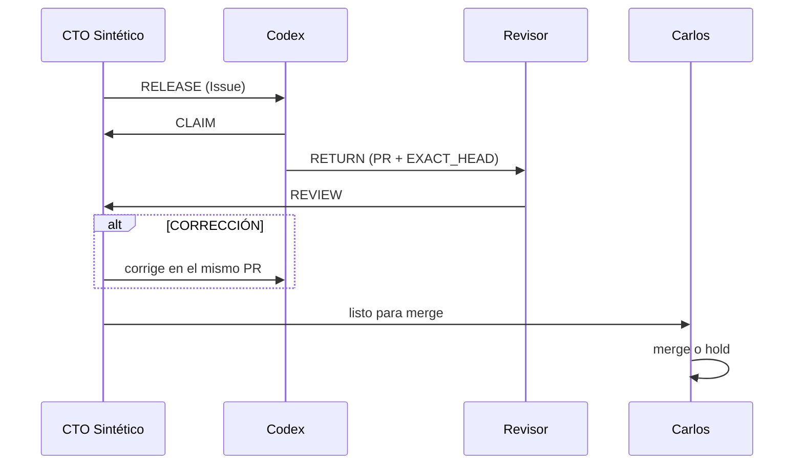

# Protocolo del squad (versión ligera para hackathon)

## 1. Una misión = un Issue

Cada **resultado demostrable** vive en un Issue creado con la plantilla **Misión** (nada de Issues para microtareas). Para retomar trabajo, lee el Issue de abajo hacia arriba: el último evento válido emitido por el asiento autorizado, dentro de su alcance, determina el estado; nunca desplaza decisiones L4, prohibiciones de seguridad ni autorizaciones T2.

**Guía operativa reutilizable (no cambia autoridad ni tiers):** antes del CLAIM, consultar el [índice de aprendizajes del squad](playbooks/README.md), el [preflight de LT-01](playbooks/PREFLIGHT_LT01.md) y el [Codex Delivery Loop](playbooks/CODEX_DELIVERY_LOOP.md). Para otros repositorios, adaptar el método a sus reglas vigentes; nunca copiar permisos, rutas ni políticas automáticamente.

## 2. Cuatro eventos

Cada evento es un comentario en el Issue que empieza con su nombre.

| Evento | Quién | Contenido mínimo |
|---|---|---|
| `RELEASE` | CTO Sintético | Objetivo, criterio de terminado, superficie (carpetas o archivos), tier, revisor |
| `CLAIM` | Codex | `SESSION_ID`, `ISSUE`, `WORKTREE_PATH`, `BRANCH`, `START_PIN`, `LOCKED_PATHS`, `OWNER`; commit de `main` del que parte |
| `RETURN` | Codex | PR, commit exacto (`EXACT_HEAD`), qué hizo, cómo probarlo, qué falta |
| `REVIEW` | Revisor independiente (Hack Ops / Cursor vía Grok; no el productor) | Commit revisado, `PASS` o `CORRECCIÓN` con hallazgos (bloqueante o no); pruebas ejecutadas vs solo inspeccionadas |

Después de `REVIEW: PASS`, el CTO da el visto bueno y **Carlos hace merge**. Una corrección se resuelve en el **mismo PR**.



## 3. Superficies (quién aparta qué)

- Un dueño por superficie. Se aparta en el `CLAIM`.
- Por defecto: `src/` y `experiments/` son de Codex (único ejecutor de código del MVP); `docs/` es de Hack Ops y del CTO. Antigravity no aparta superficie del repo: opera el entorno LT01 dentro de autorizaciones L4, sin tocar el producto.
- ¿Necesitas algo fuera de tu superficie? **Detente** y pídelo en el Issue; no lo toques.
- Leer y revisar no aparta nada y puede hacerse en paralelo.

### Sesiones concurrentes

- Un Issue/`RELEASE` **asigna trabajo**; no aísla procesos ni directorios.
- Todo `CLAIM` de escritura **T1** declara: `SESSION_ID`, `ISSUE`, `WORKTREE_PATH`, `BRANCH`, `START_PIN`, `LOCKED_PATHS`, `OWNER`. Sin worktree separado: **máximo una** sesión escritora del mismo checkout. Sesiones **T0** pueden observar en paralelo.
- **Una sola sesión escritora por superficie mutable.** Dos terminales no implican dos worktrees. Trabajo paralelo real: worktrees y ramas separados, superficies sin solapamiento y capacidad del nodo validada. No crear dos escritores solo porque existen dos terminales.
- Si el Issue asignado está bloqueado, la sesión **no adopta otra misión**: registra `STOP` y aguarda reasignación expresa. Un `RELEASE` no autoriza múltiples `CLAIM` activos sobre el mismo Issue.
- Antes de editar o hacer commit verificar: `pwd`, `git rev-parse --show-toplevel`, `git status --short`, `git branch --show-current`, `git worktree list --porcelain`. Cambios externos inesperados ⇒ `STOP`, preservar datos; **prohibido** `reset --hard` / `clean`.
- Tras `RETURN`, el productor queda **en pausa** hasta `REVIEW` independiente. Un único responsable de correcciones en el mismo PR; **L4** hace merge.
- El `REVIEW` independiente de código puede ejecutarlo **Cursor operado por Grokbot desde la nube** sobre el SHA exacto, en checkout aislado y **read-only** de la rama del productor. Grok firma la revisión en el PR, indica qué pruebas ejecutó Cursor y cuáles solo inspeccionó, y clasifica hallazgos. No se transfieren secretos ni se otorgan credenciales o derechos de escritura nuevos.
- En LT-01, no imponer worktrees simultáneos si la **RAM** no lo permite: aislamiento del filesystem y concurrencia de procesos son decisiones distintas.

## 4. Niveles de riesgo

| Tier | Qué cubre | Quién autoriza |
|---|---|---|
| **T0** | Leer, investigar, evaluar | Nadie; libre |
| **T1** | Código o docs en este repo por PR | La misión + merge de Carlos |
| **T2 en perímetro** | Llamadas a la API dentro de un perímetro autorizado (proveedor, modelo, presupuesto, periodo) | Carlos, **una vez**, como `L4_DECISION` en el Issue |
| **T2 fuera de perímetro** | Deploy, exponer algo a internet (p. ej. túneles), otro proveedor, datos reales, crear service accounts o vaults | **Carlos, acción por acción** |

Un PASS en T1 **no** autoriza nada de T2.

## 5. La revisión independiente

- La hace alguien distinto del productor, en una sesión limpia, sobre el commit exacto.
- Un subagente del mismo productor **no cuenta** como revisión independiente.
- **Codex** es el productor T1; **Cursor/Grok** revisan sin escritura (véase «Sesiones concurrentes»).
- Se mide por los defectos útiles que encuentra, no por cuántos PASS da.

## 6. Cuándo detenerse (STOP)

Detente, reporta en el Issue y espera decisión si:

- Vas a tocar algo fuera de tu superficie.
- Aparecen cambios externos inesperados en tu checkout (no `reset --hard` / `clean`).
- Tu Issue está bloqueado: no adoptes otra misión sin reasignación expresa.
- Aparece un secreto o una credencial expuesta, o un valor de secreto fuera de 1Password.
- La acción es T2 y no tiene el ok de Carlos.
- No está claro quién tiene la autoridad.

## 7. RETURN mínimo

```text
RETURN
PR:
EXACT_HEAD:
QUÉ HICE:
CÓMO PROBARLO:
QUÉ FALTA / RIESGOS:
```

## 8. Perímetro T2 (plantilla de `L4_DECISION`)

```text
L4_DECISION · PERÍMETRO T2
PROVEEDOR:      (p. ej. OpenAI)
MODELOS:        (p. ej. los que fije el RELEASE)
PRESUPUESTO:    (tope en USD)
PERIODO:        (p. ej. 2026-11-09 12:00–17:00 CDMX)
SECRETO:        op://<vault>/<item>/<campo> (1Password)
FUERA DE ALCANCE: deploy, túneles, otros proveedores, datos reales
```
